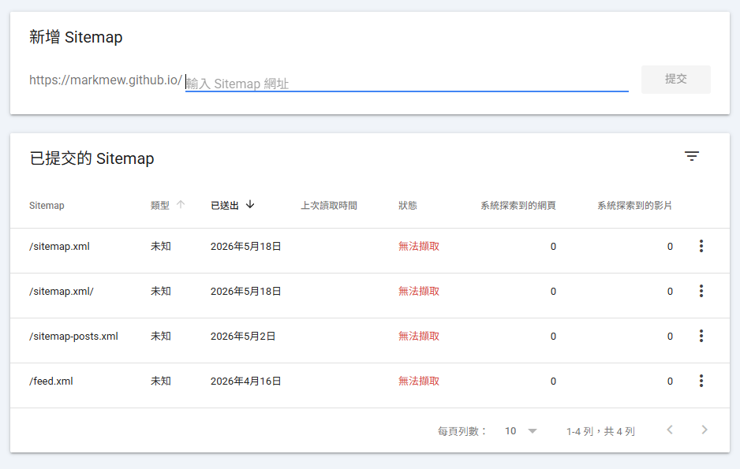
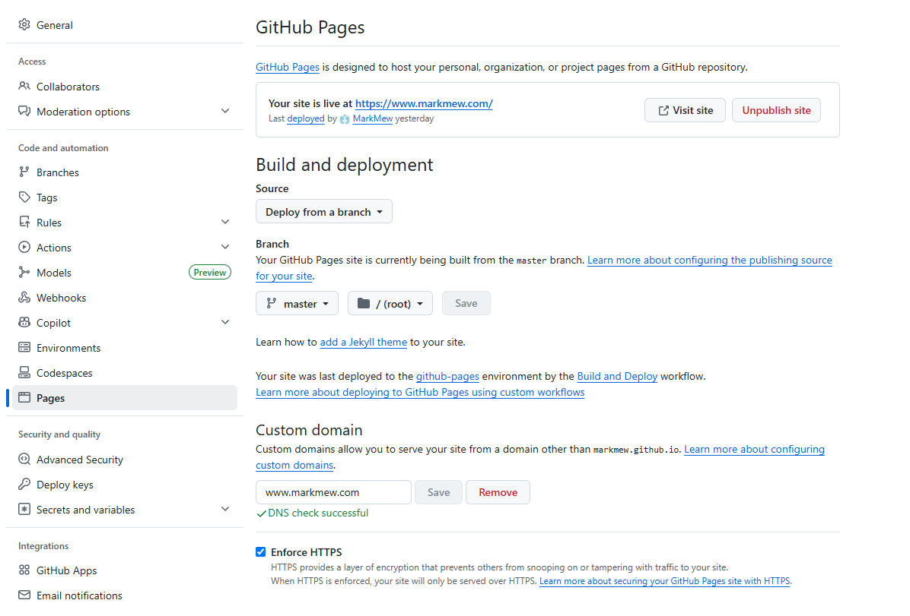
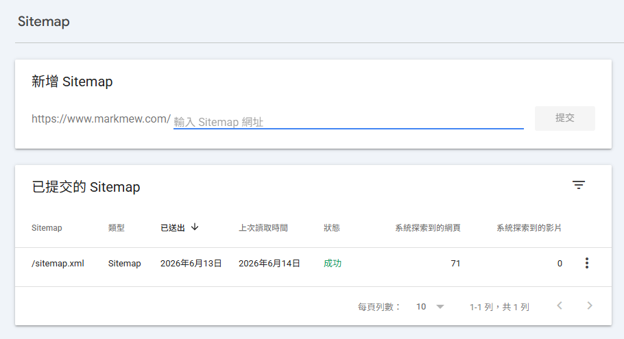
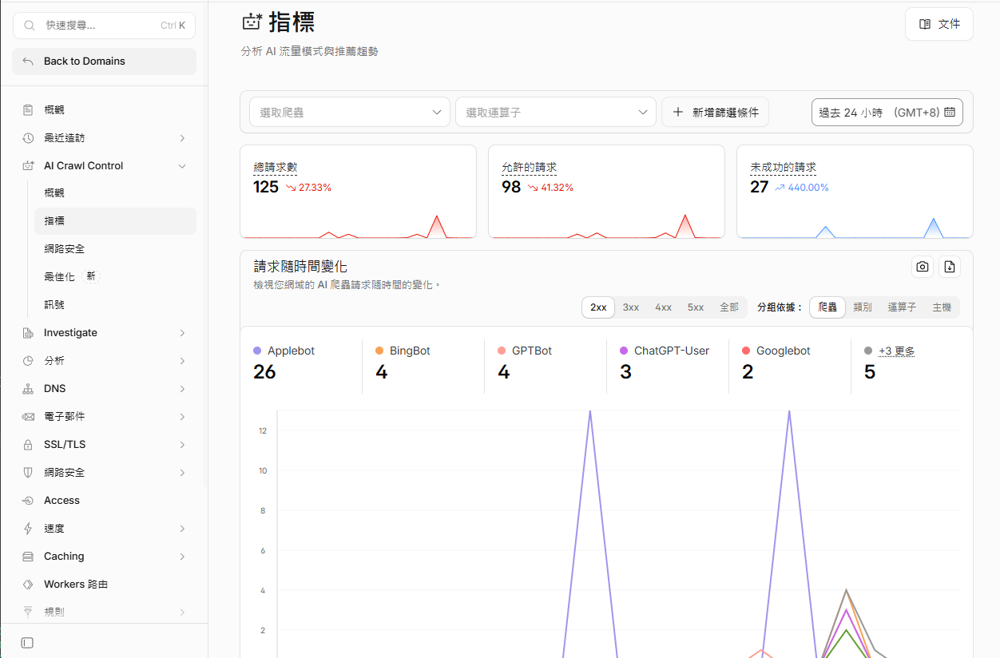

This is an account of a sitemap problem I encountered while moving a GitHub Pages site to a custom domain. After the move, Search Console eventually fetched my sitemap. That sequence does not establish that a custom domain is required or that it speeds up indexing. A site on a `github.io` address can submit a sitemap too.

If Search Console reports `Couldn't fetch`, first check the exact sitemap URL, its HTTP response, robots.txt, redirects, and the property you submitted it under. Google lists several possible fetch failures; a domain purchase is not one of its requirements. See the [Search Console sitemaps report help](https://support.google.com/webmasters/answer/7451001).

## How I Stepped on This Landmine

### Background

Around February or March,

I decided to start taking my GitHub Pages site seriously.

First, I replaced the site with a new theme,

then I connected Google Analytics and Google Search Console for management.

The Google Analytics tracking code was verified very quickly.

Google Search Console was also verified smoothly because it could be linked directly through Google Analytics.

But after submitting the sitemap multiple times in Google Search Console,



I was honestly speechless.

Not only did I fail to fix the issue,

I also wasted a lot of time discussing it with AI tools and burning tokens on meaningless changes.

### The Useless Modification Loop

#### Useless Suggestions from AI

- `site.url` is wrong
- `Sitemap URL` and `GSC property` do not match
- The `<lastmod>` format may be invalid
- The plugin is not supported, so another plugin should generate the sitemap
- `robots.txt` is blocking it
- The sitemap contains "invalid URLs" such as js or css assets
- The URL does not actually exist
- Use the simplest possible sitemap

My sitemap was generated with AI tools,

or built with AI-assisted development.

In the end, I validated it with online tools,

and confirmed that it was valid XML and also a valid sitemap.xml.

However, after adding the sitemap in Google Search Console,

the status was always `Couldn't fetch`.

I am not saying the AI suggestions were bad.

If this were a pure static site hosted on Apache2,

or a server managed by myself,

those suggestions would make sense as a checklist.

But in this case, I was using a static website hosting service,

with many OS-level details that I could not touch.

So those checks may not have been very meaningful.

#### A Bare-Minimum sitemap.xml

Since a fancy sitemap might contain elements that Google would ignore,

I also tried an almost bare-minimum sitemap.xml.

It only contained the site itself and posts,

without update frequency hints.

But in the end, GSC still did not accept it.

```xml
<?xml version="1.0" encoding="UTF-8"?>
<urlset xmlns="http://www.sitemaps.org/schemas/sitemap/0.9">

  <url>
    <loc>https://markmew.github.io/</loc>
  </url>

  
  <url>
    <loc>{{ site.url }}{{ post.url }}</loc>
    <lastmod>{{ post.date | date_to_xmlschema }}</lastmod>
  </url>
  

</urlset>
```

#### What I could and could not verify

The sitemap XML was valid in my local checks, and changing the domain coincided with a successful submission. I did not capture evidence that Google treated `github.io` as less trustworthy, or that a particular CDN edge caused the fetch error. Those explanations should not be treated as findings from this case.

A local `curl` request also does not reproduce every request Google makes. Use the Sitemaps report and server response details to narrow down an actual fetch failure before changing hosting or DNS.

## How I Solved It

### Buying a Domain

I had previously bought domains from GoDaddy.

But CloudFlare has always had some interesting features.

This time, because of those features,

I decided to buy the domain on CloudFlare.

#### DNS Service

As everyone knows, Google DNS is `8.8.8.8`.

CloudFlare also provides a DNS service: `1.1.1.1`.

So if I buy and configure the domain there,

maybe DNS propagation will be faster too.

#### Built-In CDN

Even the free version of CloudFlare includes CDN support.

If I point my domain to CloudFlare,

then for a content-focused GitHub Pages site,

I probably do not need to buy or think about a separate CDN service.

### CloudFlare Setup

To point CloudFlare to GitHub Pages, you need to configure four A records and one CNAME record.

| Type | Name | Value |
| --- | --- | --- |
| A | @ | 185.199.110.153 |
| A | @ | 185.199.111.153 |
| A | @ | 185.199.109.153 |
| A | @ | 185.199.108.153 |
| CNAME | www | markmew.github.io |

### Custom Domain

In the `Pages` tab on the left,

the `Custom domain` section at the bottom lets you set a custom domain.

DNS verification may take some time.

Also, every time you refresh the page,

GitHub Pages checks the DNS status again.

After adding the domain, all you can do is wait patiently and `do not` refresh the page.

Wait until you see `DNS check successful`.

At this point, I recommend enabling Enforce HTTPS.



### Submitting the Sitemap

Then we return to Google Search Console.

Unlike GA, GSC does not let you directly change the URL of an existing property.

So you can only add a new property,

and submit the sitemap from that new property.

After submission, Google showed success very quickly.



### An Extra Bonus

After the sitemap submission succeeded,

I went back the next day to explore some CloudFlare features.

Unexpectedly, CloudFlare provides metrics for AI crawlers.

You can see whether your site has been crawled by AI bots,

or even included by AI agents.



## Conclusion

Looking back at the whole process, I spent a lot of time checking sitemap, robots.txt, and all kinds of settings.

In my case, the sitemap became fetchable after I configured a custom domain. The available evidence does not show which change resolved the earlier error. A custom domain is optional for GitHub Pages sitemap submission, and a successful submission does not guarantee indexing. When the report says `Couldn't fetch`, check the reported error and the sitemap response first.
