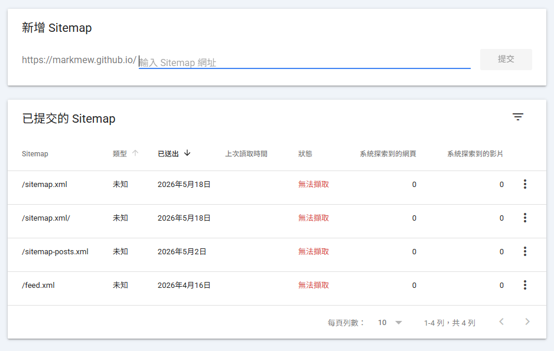
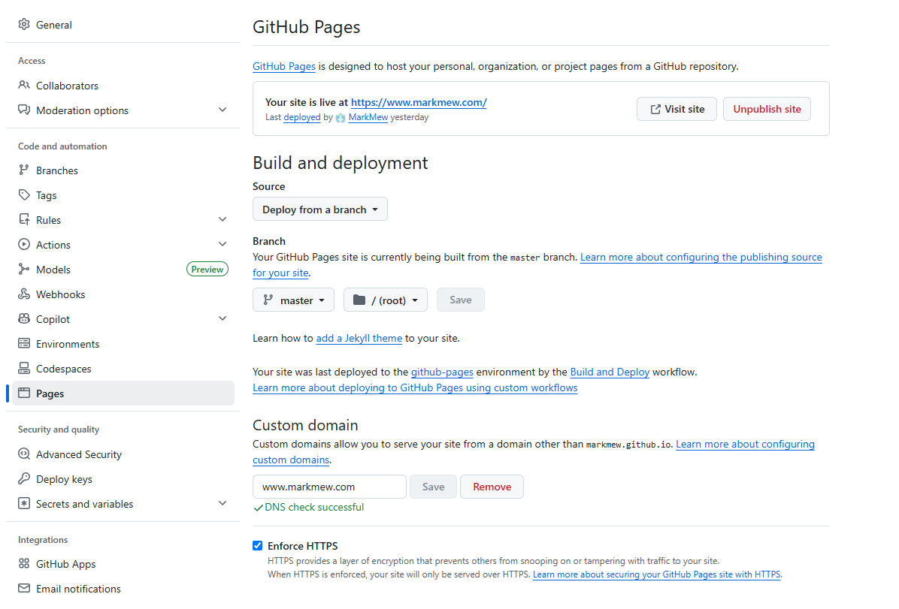
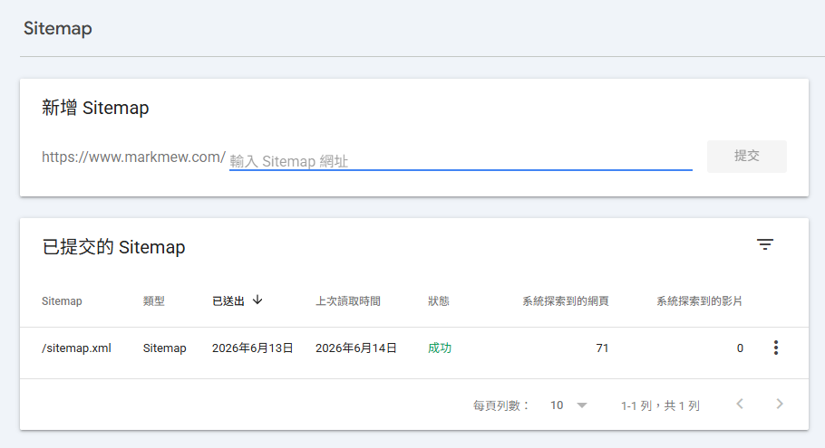
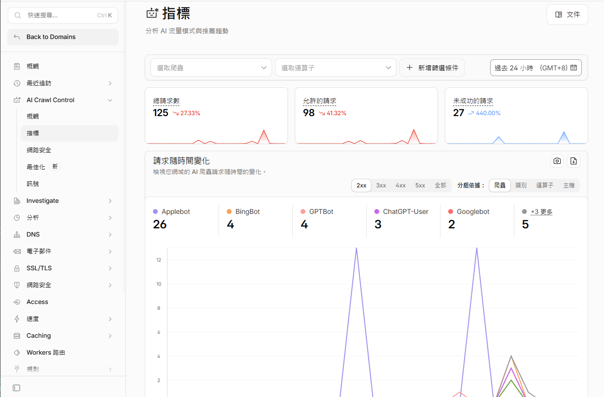

この記事は、GitHub Pages のサイトをカスタムドメインに移行した際に経験したサイトマップの取得エラーについての記録です。移行後に Search Console がサイトマップを取得できるようになりましたが、その前後関係だけでは、カスタムドメインが必要だった、あるいはインデックス登録が速くなったとは言えません。`github.io` のサイトでもサイトマップは送信できます。

`取得できませんでした` と表示されたら、まずサイトマップの正確な URL、HTTP 応答、robots.txt、リダイレクト、送信先のプロパティを確認してください。Google が挙げる原因は [Search Console のサイトマップレポートのヘルプ](https://support.google.com/webmasters/answer/7451001)で確認できます。

## ハマった経緯

### 背景

だいたい 2 月か 3 月ごろ、

GitHub Pages をちゃんと運用してみようと思いました。

まずこのサイトのテーマを新しいものに差し替え、

Google Analytics と Google Search Console も紐づけて管理を始めました。

Google Analytics のトラッキングコードはすぐに認証できました。

Google Search Console も Google Analytics と直接連携できたので、

こちらもすぐに認証できました。

ところが、Google Search Console で何度も Sitemap を送信したあと、



本当に何も言えなくなりました。

設定を直せなかっただけでなく、

AI ツールとやり取りしながら、意味のない修正に時間と Token をかなり使ってしまいました。

### 役に立たなかった修正ループ

#### AI から出てきた役に立たない提案

- `site.url` が間違っている
- `Sitemap URL` と `GSC property` が一致していない
- `<lastmod>` の形式に問題があるかもしれない
- plugin が対応していないので、別の plugin で sitemap を生成すべき
- `robots.txt` がブロックしている
- sitemap に「無効な URL」（js や css などのリソース）が含まれている
- URL が実際には存在しない
- とにかく最小構成の sitemap を使う

私の sitemap は AI ツールを使って作成したもの、

または AI の補助を受けて開発したものでした。

最終的にはオンラインツールでも検証し、

正しい XML であり、正しい sitemap.xml であることも確認しました。

それでも Google Search Console で sitemap を追加すると、

ステータスはずっと `取得できませんでした` のままでした。

AI ツールの提案が悪いと言いたいわけではありません。

Apache2 上に置いた純粋な静的ページや、

自分で管理しているサーバーであれば、

チェックリストとして一つずつ確認する価値はあると思います。

ただ今回は静的サイトのホスティングサービスを使っていて、

OS レベルで触れない部分も多くあります。

そのため、あまり参考にならない確認項目もありました。

#### 最小構成の sitemap.xml

凝った sitemap には、採用されない要素が入る可能性があります。

そのため、ほぼ最小構成の sitemap.xml も試しました。

サイト本体と posts だけを含め、

更新頻度のヒントも入れていません。

それでも最終的に GSC には採用されませんでした。

```xml
<?xml version="1.0" encoding="UTF-8"?>
<urlset xmlns="http://www.sitemaps.org/schemas/sitemap/0.9">

  <url>
    <loc>https://markmew.github.io/</loc>
  </url>

  
  <url>
    <loc>{{ site.url }}{{ post.url }}</loc>
    <lastmod>{{ post.date | date_to_xmlschema }}</lastmod>
  </url>
  

</urlset>
```

#### この事例で確認できたこと

ローカルでの検証ではサイトマップの XML は正しく、ドメインの変更後に送信が成功しました。ただし、Google が `github.io` を低く評価した証拠や、特定の CDN ノードが取得エラーを起こした証拠はありません。これらを原因として断定することはできません。

手元の `curl` が成功しても、Google のすべてのリクエストを再現したことにはなりません。ホスティングや DNS を変更する前に、サイトマップレポートと実際の HTTP 応答を確認します。

## 解決までの流れ

### ドメインを購入する

以前は GoDaddy でドメインを購入していました。

ただ、CloudFlare には以前から面白い機能がいくつかあります。

今回はその機能を試したいこともあり、

CloudFlare でドメインを購入することにしました。

#### DNS サービス

よく知られているように、Google DNS は `8.8.8.8` です。

CloudFlare も DNS サービス `1.1.1.1` を提供しています。

ここでドメインを購入して設定すれば、

DNS の反映も少し速いのではないか、という期待もありました。

#### 内蔵 CDN

CloudFlare は無料プランでも CDN を内蔵しています。

CloudFlare に向けて設定すれば、

コンテンツサイト中心の GitHub Pages であれば、

別途 CDN サービスを購入したり検討したりしなくてもよさそうです。

### CloudFlare の設定

CloudFlare を GitHub Pages に向けるには、4 つの A Record と 1 つの CNAME Record を設定します。

| Type | Name | Value |
| --- | --- | --- |
| A | @ | 185.199.110.153 |
| A | @ | 185.199.111.153 |
| A | @ | 185.199.109.153 |
| A | @ | 185.199.108.153 |
| CNAME | www | markmew.github.io |

### カスタムドメイン

左側の `Pages` タブを開き、

一番下にある `Custom domain` からカスタムドメインを設定できます。

DNS の検証には少し時間がかかる場合があります。

しかもページを更新するたびに、

DNS の状態確認が再実行されます。

ドメインを追加したら、あとは辛抱強く待ち、`更新しない` ことです。

`DNS check successful` と表示されるまで待ちます。

このタイミングで Enforce HTTPS を有効にすることをおすすめします。



### サイトマップを送信する

次に Google Search Console に戻ります。

GSC は GA と違い、既存プロパティの URL を直接変更できません。

そのため、新しいプロパティを追加する必要があります。

そして、その新しいプロパティから sitemap を送信します。

送信後、Google はすぐに成功と表示しました。



### 追加の収穫

Sitemap の送信に成功したあと、

翌日に CloudFlare の機能をいくつか見ていました。

すると、AI クローラー向けの指標が提供されていることに気づきました。

自分のサイトが AI クローラーにクロールされたかどうか、

さらには AI Agent に取り込まれているかどうかまで確認できます。



## まとめ

今回の流れを振り返ると、sitemap、robots.txt、各種設定の確認にかなり時間を使いました。

私の環境ではカスタムドメインの設定後にサイトマップを取得できるようになりました。ただし、以前のエラーを解消した変更は特定できていません。カスタムドメインはサイトマップ送信の必須条件ではなく、送信成功もインデックス登録を保証しません。`取得できませんでした` と表示されたら、まずエラーの詳細とサイトマップの応答を確認してください。
