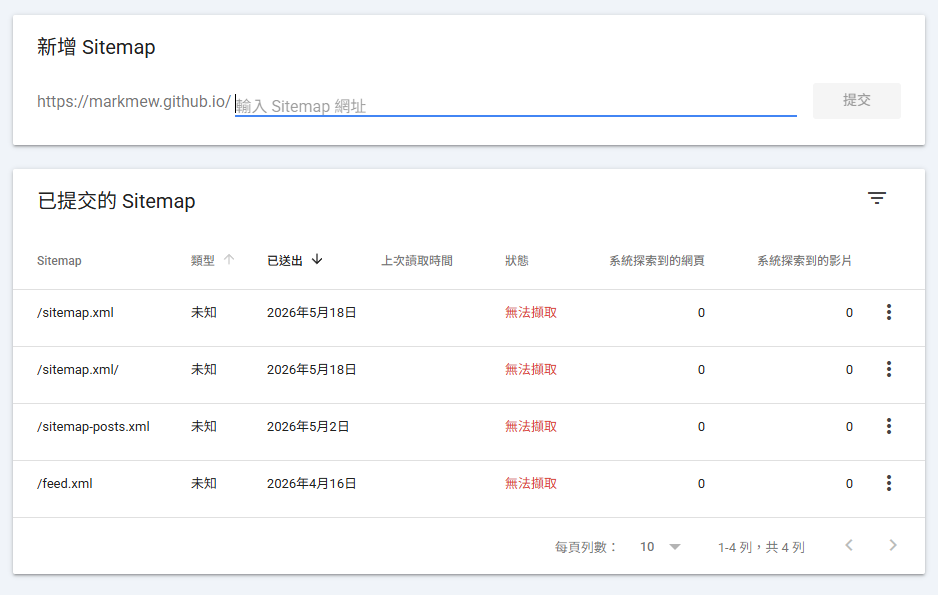
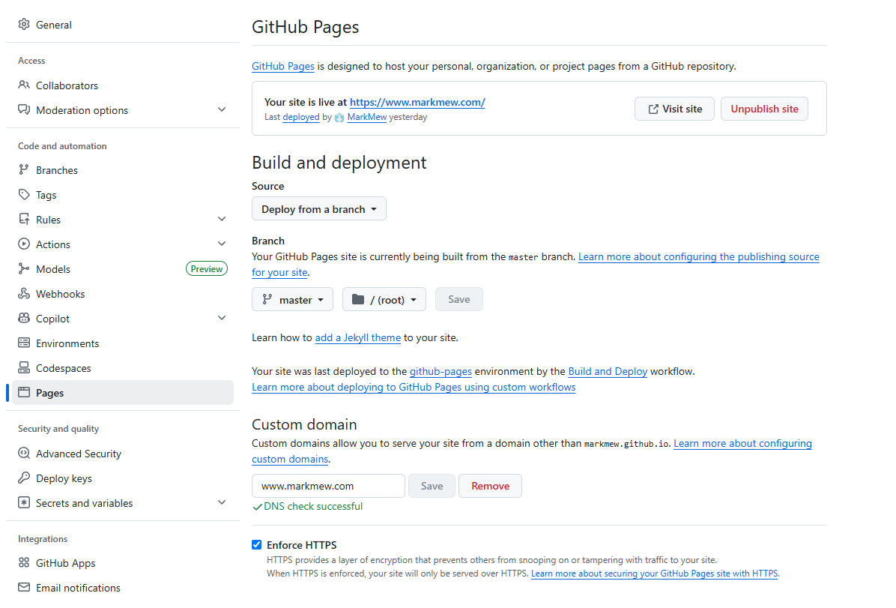
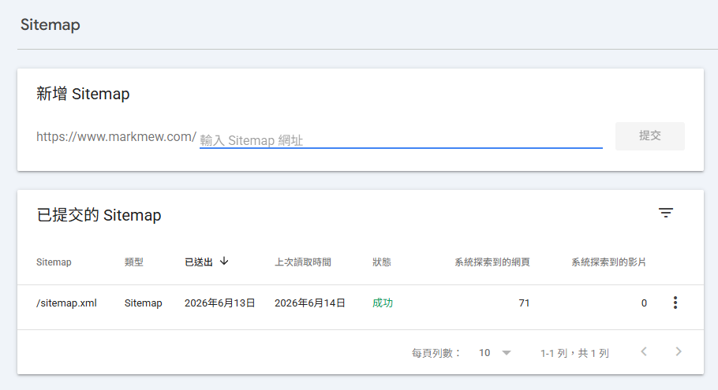
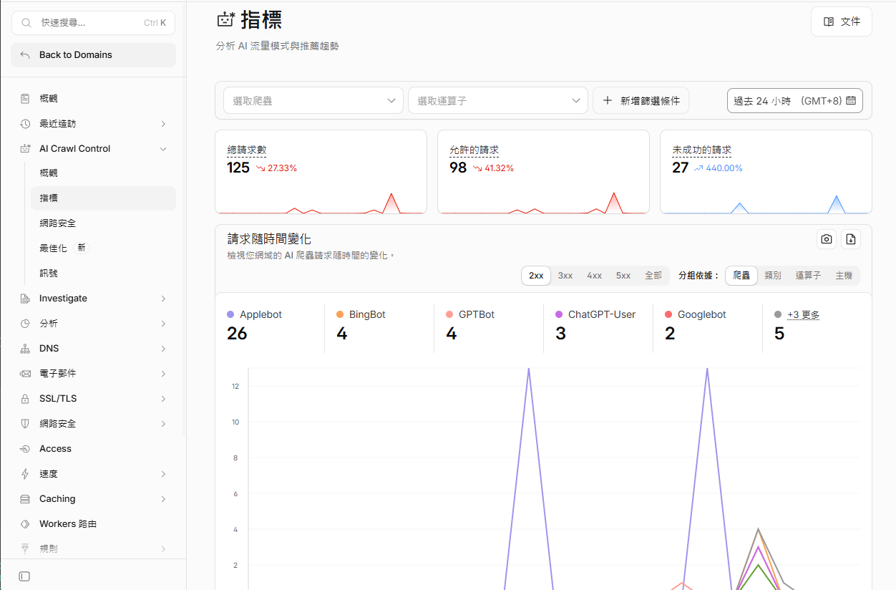

這篇記錄我把 GitHub Pages 網站改用自訂網域前後，Search Console 擷取 sitemap 的狀況。設定網域後，sitemap 最終成功擷取；但僅憑時間先後，無法證明自訂網域是必要條件，也無法證明它會加快文章收錄。使用 `github.io` 網址的網站同樣可以提交 sitemap。

如果 Search Console 顯示「無法擷取」，應先核對 sitemap 網址、HTTP 回應、robots.txt、重新導向與提交的資源類型。Google 列出的可能原因見 [Search Console 網站地圖報表說明](https://support.google.com/webmasters/answer/7451001)。

## 踩雷過程

### 背景

約莫二月三月左右，

我決定開始認真經營 GitHub Pages，

先將這個網站替換新的版型，

並綁定 Google Analytics 和 Google Search Console 開始管理，

Google Analytics 的追蹤碼很快就認證完成，

Google Search Console 則是因為 Google Analytics 可以直接關聯，

所以也很快就認證成功，

不過在 Google Search Console 多次提交 Sitemap 後，



我真的是扯底無語了，

不僅沒有調整好，

還讓我浪費許多時間跟 AI 溝通互動和浪費 Token 做無意義的修改。

### 無用的修改循環

#### AI 的無用建議

- `site.url` 寫錯
- `Sitemap URL` 與 `GSC property` 不一致
- `<lastmod>` 格式可能出問題
- plugin 不支援，應該引用其他 plugin 產生 sitemap
- `robots.txt` 擋掉
- sitemap 裡面有「無效 URL」（指 js、css 這類資源）
- URL 實際不存在
- 使用最最最陽春的 sitemap

我的 sitemap 就是使用 AI 工具，

或是透過 AI 輔助開發產生的，

最後使用線上工具驗證，

也確認這是個合法的 xml 也是合法的 sitemap.xml，

不過在 Google Search Console 中新增 sitemap 後狀態永遠都是 `無法擷取`。

不是說 AI 工具給的建議不好，

如果是架設在 Apache2 上的純靜態頁面，

或是自己管理的伺服器，

我覺得都可以列為檢查清單逐一確認，

不過今天是使用靜態網頁代管服務（？），

或是有很多 OS 層級我們無法接觸到的地方，

也許就沒有參考意義。

#### 陽春的 sitemap.xml

考慮到絢麗的 sitemap 可能加入很多不會被採用的元素，

當然也使用過近乎陽春的的 sitemap.xml，

幾乎是只有網站本身和 posts，

沒有更新頻率建議，

不過最終仍沒有被 GSC 採用。

```xml
<?xml version="1.0" encoding="UTF-8"?>
<urlset xmlns="http://www.sitemaps.org/schemas/sitemap/0.9">

  <url>
    <loc>https://markmew.github.io/</loc>
  </url>

  
  <url>
    <loc>{{ site.url }}{{ post.url }}</loc>
    <lastmod>{{ post.date | date_to_xmlschema }}</lastmod>
  </url>
  

</urlset>
```

#### 這次能確認的範圍

本機檢查顯示 sitemap XML 格式正確；變更網域後，提交也成功了。但我沒有證據顯示 Google 降低 `github.io` 網站的信任度，或某個 CDN 節點造成擷取失敗。這些推測不能當成這次問題的原因。

本機 `curl` 成功，也不代表重現了 Google 的所有請求。變更主機或 DNS 前，應先看 Search Console 的錯誤細節和實際的 HTTP 回應。

## 解決過程

### 購買網域

之前在購買網域是在 GoDaddy 購買，

不過 CloudFlare 一直有一些有趣的功能，

這次是基於這些功能，

因此決定在 CloudFlare 上購買網域。


#### DNS 服務

眾所周知 Google DNS 為 `8.8.8.8`，

而 CloudFlare 也有提供 DNS 服務 `1.1.1.1`，

這樣我在這裡購買網域並進行設置，

是不是生肖會比較快。

#### 內建 CDN

免費版本的 CloudFlare 就內建 CDN，

如果我指向 CloudFlare，

這樣以內容網站為主的 Github Pages，

似乎就不用另外購買或是思考 CDN 服務。

### CloudFlare 設置

要將 CloudFlare 指向 GitHub Pages 需要設定四個 A Record 和 一個 CName Record。

| Type | Name | Value |
| --- | --- | --- |
| A | @ | 185.199.110.153 |
| A | @ | 185.199.111.153 |
| A | @ | 185.199.109.153 |
| A | @ | 185.199.108.153 |
| CNAME | www | markmew.github.io |

### 自定義網域

左邊的 `Pages` 分頁中，

最下面的 `Custom domain` 就可以自定義網域，

驗證 DNS 可能需要一點時間，

而且每次重新整理頁面，

都會重新確認 DNS 狀態，

添加完網域就只能耐心等待而且`不要`重新整理頁面，

等到出現 `DNS check successful` 的字眼

這時候會建議勾選 Enforce HTTPS



### 提交網站地圖

接著我們又回到 Google Search Console，

GSC 不像 GA 可以直接改資源的網址，

因此只能新增一個資源，

然後再從新的資源提交 sitemap，

提交後很快 Google 就顯示成功



### 更多的收穫

Sitemap 提交成功後，

隔天回頭查看 CloudFlare 的一些功能，

沒想到有提供 AI 爬蟲的指標，

可以看到自己的網站是否有被 AI 爬蟲爬過，

甚至收錄進 AI Agent 中。



## 結語

回顧整個過程，我花了不少時間在檢查 sitemap、robot.txt 以及各種設定，

在我的網站上，設定自訂網域後 sitemap 成功擷取，但現有紀錄不足以確認是哪項變更排除了原本的錯誤。自訂網域並非提交 sitemap 的必要條件，提交成功也不保證建立索引。遇到「無法擷取」時，先檢查報表中的錯誤與 sitemap 的實際回應。
